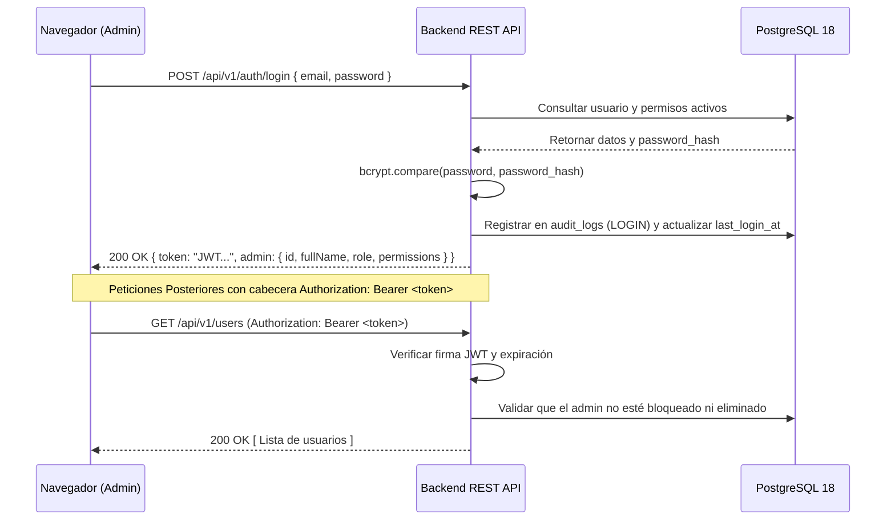

# Kynectia - Autenticación y Control de Acceso (RBAC)

## 1. Arquitectura de Seguridad

La seguridad del panel administrativo de Kynectia se basa en el principio de defensa en profundidad, combinando validación estricta en el servidor, sesiones seguras basadas en JSON Web Tokens (JWT), almacenamiento seguro de credenciales con bcrypt y autorización granular basada en roles y permisos (RBAC).

---

## 2. Almacenamiento Seguro de Credenciales

1. **Algoritmo de Hash:** Se utiliza `bcrypt` con un factor de costo (salt rounds) configurado en **12**.
2. **Protección contra ataques de diccionario y Rainbow Tables:** Cada contraseña genera una sal criptográfica única e impredecible.
3. **Validación de Complejidad:** Las contraseñas deben contener un mínimo de 8 caracteres.
4. **Verificación en el Servidor:** La comparación de hashes se realiza exclusivamente en el backend utilizando `bcrypt.compare`, protegiendo el sistema contra ataques de temporización.

---

## 3. Flujo de Sesión y Tokens JWT

### Características del Token:
- **Expiración:** 8 horas (`8h`) por defecto.
- **Firma Criptográfica:** Algoritmo HMAC SHA-256 utilizando la clave secreta `JWT_SECRET`.
- **Almacenamiento en Cliente:** LocalStorage seguro con interceptor que elimina el token y redirige a la pantalla de login al detectar códigos HTTP `401 Unauthorized`.

---

## 4. Control de Acceso Basado en Roles (RBAC)

El sistema soporta jerarquía de roles y permisos granulares asignables:

| Rol | Descripción | Permisos Clave |
|---|---|---|
| **`superadmin`** | Acceso y control total | Acceso irrestricto (`*`), gestión de administradores y auditoría |
| **`trainer`** | Entrenador administrativo | `users:manage`, `muscles:manage`, `exercises:manage`, `routines:manage` |
| **`editor`** | Editor de contenidos y marketing | `ads:manage`, `plans:manage`, subida multimedia |

### Permisos Granulares Registrados en PostgreSQL:
- `users:manage`: Crear, modificar, activar, desactivar y dar de baja usuarios atletas.
- `muscles:manage`: Gestionar la segmentación de grupos musculares.
- `exercises:manage`: Administrar el catálogo maestro de ejercicios y asignaciones N:M.
- `equipment:manage`: Controlar el inventario de implementos deportivos.
- `routines:manage`: Crear, estructurar, secuenciar y versionar rutinas de entrenamiento.
- `plans:manage`: Administrar la oferta comercial, tarifas y beneficios.
- `ads:manage`: Configurar campañas publicitarias internas y vigencia de banners.
- `audit:view`: Consultar la bitácora inmutable de auditoría y seguridad.

---

## 5. Auditoría y Trazabilidad

Cada operación administrativa de creación, actualización, cambio de estado, publicación o eliminación se registra de forma obligatoria en la tabla `audit_logs` de PostgreSQL incluyendo:
- Identificador y correo del administrador actuante.
- Acción ejecutada (`CREATE`, `UPDATE`, `DELETE`, `STATUS_CHANGE`, `PUBLISH`, `LOGIN`, `LOGOUT`).
- Módulo afectado y registro ID.
- Snapshot JSONB de valores anteriores y posteriores para auditoría forense.
- Dirección IP y User Agent del navegador cliente.
