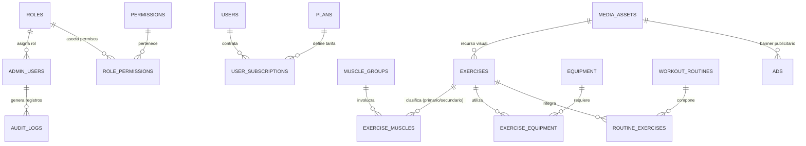

# Kynectia - Esquema de Base de Datos PostgreSQL

## 1. Visión General
La base de datos relacional de **Kynectia** está implementada en **PostgreSQL 18** bajo un esquema normalizado en tercera forma normal (3NF). Implementa restricciones estrictas de integridad referencial, índices para consultas frecuentes, triggers automatizados para actualización de marcas de tiempo (`updated_at`), marcas de borrado lógico (`deleted_at`), tipos JSONB para estructuras flexibles (beneficios y payloads de auditoría) y control de dependencias entre entidades.

---

## 2. Diagrama de Entidad-Relación (ER)

---

## 3. Diccionario de Datos

### 3.1 `roles`
Define los roles del sistema administrativo.
- `id`: SERIAL PRIMARY KEY
- `name`: VARCHAR(50) UNIQUE NOT NULL (`superadmin`, `trainer`, `editor`)
- `description`: TEXT
- `created_at`: TIMESTAMPTZ DEFAULT NOW()
- `updated_at`: TIMESTAMPTZ DEFAULT NOW()

### 3.2 `permissions`
Permisos granulares por módulo.
- `id`: SERIAL PRIMARY KEY
- `code`: VARCHAR(100) UNIQUE NOT NULL (`users:manage`, `exercises:manage`, etc.)
- `description`: TEXT
- `module`: VARCHAR(50) NOT NULL
- `created_at`: TIMESTAMPTZ DEFAULT NOW()

### 3.3 `role_permissions`
Relación N:M entre roles y permisos.
- `role_id`: INT REFERENCES roles(id) ON DELETE CASCADE
- `permission_id`: INT REFERENCES permissions(id) ON DELETE CASCADE
- PRIMARY KEY (role_id, permission_id)

### 3.4 `admin_users`
Cuentas de administradores del sistema web.
- `id`: SERIAL PRIMARY KEY
- `full_name`: VARCHAR(150) NOT NULL
- `email`: VARCHAR(150) UNIQUE NOT NULL
- `password_hash`: VARCHAR(255) NOT NULL (bcrypt, 12 rounds)
- `role_id`: INT REFERENCES roles(id) ON DELETE RESTRICT
- `is_active`: BOOLEAN DEFAULT TRUE
- `last_login_at`: TIMESTAMPTZ
- `created_at`: TIMESTAMPTZ DEFAULT NOW()
- `updated_at`: TIMESTAMPTZ DEFAULT NOW()
- `deleted_at`: TIMESTAMPTZ (Soft delete)
- **Índices:** `idx_admin_users_email`, `idx_admin_users_is_active`

### 3.5 `audit_logs`
Bitácora inmutable de eventos y cambios administrativos.
- `id`: SERIAL PRIMARY KEY
- `admin_id`: INT REFERENCES admin_users(id) ON DELETE SET NULL
- `admin_email`: VARCHAR(150)
- `action`: VARCHAR(50) NOT NULL (`CREATE`, `UPDATE`, `DELETE`, `LOGIN`, `STATUS_CHANGE`, `PUBLISH`)
- `entity_type`: VARCHAR(50) NOT NULL
- `entity_id`: VARCHAR(50)
- `old_values`: JSONB
- `new_values`: JSONB
- `ip_address`: VARCHAR(45)
- `user_agent`: TEXT
- `created_at`: TIMESTAMPTZ DEFAULT NOW()
- **Índices:** `idx_audit_logs_admin_id`, `idx_audit_logs_entity`, `idx_audit_logs_created_at`

### 3.6 `users`
Atletas y usuarios finales de la plataforma deportiva.
- `id`: SERIAL PRIMARY KEY
- `full_name`: VARCHAR(150) NOT NULL
- `email`: VARCHAR(150) UNIQUE NOT NULL
- `phone`: VARCHAR(30)
- `avatar_url`: TEXT
- `birth_date`: DATE
- `gender`: VARCHAR(20) (`male`, `female`, `other`, `unspecified`)
- `height_cm`: NUMERIC(5,2)
- `weight_kg`: NUMERIC(5,2)
- `fitness_goal`: VARCHAR(100) (`hypertrophy`, `strength`, `fat_loss`, `endurance`, `toning`)
- `is_active`: BOOLEAN DEFAULT TRUE
- `email_verified`: BOOLEAN DEFAULT FALSE
- `created_at`: TIMESTAMPTZ DEFAULT NOW()
- `updated_at`: TIMESTAMPTZ DEFAULT NOW()
- `deleted_at`: TIMESTAMPTZ (Soft delete / Anonimización)
- **Índices:** `idx_users_email`, `idx_users_is_active`, `idx_users_created_at`

### 3.7 `muscle_groups`
Segmentación anatómica deportiva.
- `id`: SERIAL PRIMARY KEY
- `name`: VARCHAR(100) UNIQUE NOT NULL
- `description`: TEXT
- `image_url`: TEXT
- `is_active`: BOOLEAN DEFAULT TRUE
- `created_at`: TIMESTAMPTZ DEFAULT NOW()
- `updated_at`: TIMESTAMPTZ DEFAULT NOW()
- `deleted_at`: TIMESTAMPTZ
- **Índices:** `idx_muscle_groups_name`, `idx_muscle_groups_is_active`

### 3.8 `equipment`
Catálogo de implementos y maquinaria deportiva.
- `id`: SERIAL PRIMARY KEY
- `name`: VARCHAR(100) UNIQUE NOT NULL
- `description`: TEXT
- `category`: VARCHAR(50) NOT NULL (`free_weights`, `machines`, `bodyweight`, `accessories`, `resistance`)
- `image_url`: TEXT
- `is_active`: BOOLEAN DEFAULT TRUE
- `created_at`: TIMESTAMPTZ DEFAULT NOW()
- `updated_at`: TIMESTAMPTZ DEFAULT NOW()
- `deleted_at`: TIMESTAMPTZ
- **Índices:** `idx_equipment_name`, `idx_equipment_category`, `idx_equipment_is_active`

### 3.9 `exercises`
Catálogo maestro de movimientos deportivos.
- `id`: SERIAL PRIMARY KEY
- `name`: VARCHAR(150) UNIQUE NOT NULL
- `description`: TEXT
- `execution_instructions`: TEXT (Pasos de ejecución)
- `difficulty_level`: VARCHAR(30) DEFAULT 'intermediate' (`beginner`, `intermediate`, `advanced`)
- `exercise_type`: VARCHAR(50) DEFAULT 'strength' (`strength`, `cardio`, `flexibility`, `hiit`, `plyometric`)
- `demo_image_url`: TEXT
- `demo_video_url`: TEXT
- `safety_recommendations`: TEXT
- `publication_status`: VARCHAR(30) DEFAULT 'published' (`draft`, `published`, `archived`)
- `is_active`: BOOLEAN DEFAULT TRUE
- `created_at`: TIMESTAMPTZ DEFAULT NOW()
- `updated_at`: TIMESTAMPTZ DEFAULT NOW()
- `deleted_at`: TIMESTAMPTZ
- **Índices:** `idx_exercises_name`, `idx_exercises_difficulty`, `idx_exercises_type`, `idx_exercises_status`, `idx_exercises_is_active`

### 3.10 `exercise_muscles`
Relación N:M entre ejercicios y grupos musculares con clasificación primaria.
- `exercise_id`: INT REFERENCES exercises(id) ON DELETE CASCADE
- `muscle_group_id`: INT REFERENCES muscle_groups(id) ON DELETE RESTRICT
- `is_primary`: BOOLEAN DEFAULT FALSE NOT NULL
- PRIMARY KEY (exercise_id, muscle_group_id)

### 3.11 `exercise_equipment`
Relación N:M entre ejercicios e implementos requeridos.
- `exercise_id`: INT REFERENCES exercises(id) ON DELETE CASCADE
- `equipment_id`: INT REFERENCES equipment(id) ON DELETE RESTRICT
- PRIMARY KEY (exercise_id, equipment_id)

### 3.12 `workout_routines`
Programas de entrenamiento predefinidos.
- `id`: SERIAL PRIMARY KEY
- `name`: VARCHAR(150) NOT NULL
- `description`: TEXT
- `cover_image_url`: TEXT
- `goal`: VARCHAR(100) NOT NULL
- `difficulty_level`: VARCHAR(30) DEFAULT 'intermediate'
- `category`: VARCHAR(50) DEFAULT 'full_body'
- `estimated_duration_minutes`: INT DEFAULT 45
- `publication_status`: VARCHAR(30) DEFAULT 'draft' (`draft`, `published`, `archived`)
- `version`: INT DEFAULT 1 (Incrementa al editar rutinas publicadas)
- `is_active`: BOOLEAN DEFAULT TRUE
- `created_at`: TIMESTAMPTZ DEFAULT NOW()
- `updated_at`: TIMESTAMPTZ DEFAULT NOW()
- `deleted_at`: TIMESTAMPTZ

### 3.13 `routine_exercises`
Configuración detallada de cada ejercicio dentro de una rutina.
- `id`: SERIAL PRIMARY KEY
- `routine_id`: INT REFERENCES workout_routines(id) ON DELETE CASCADE
- `exercise_id`: INT REFERENCES exercises(id) ON DELETE RESTRICT
- `sequence_order`: INT NOT NULL (Orden de ejecución)
- `sets`: INT NOT NULL DEFAULT 3
- `reps`: INT NOT NULL DEFAULT 10
- `duration_seconds`: INT DEFAULT 0
- `rest_seconds`: INT NOT NULL DEFAULT 60
- `recommended_weight_kg`: NUMERIC(6,2)
- `specific_instructions`: TEXT
- `created_at`: TIMESTAMPTZ DEFAULT NOW()
- **Índices:** `idx_routine_exercises_routine`, `idx_routine_exercises_exercise`

### 3.14 `plans`
Oferta comercial de membresías y precios.
- `id`: SERIAL PRIMARY KEY
- `name`: VARCHAR(100) UNIQUE NOT NULL
- `description`: TEXT
- `billing_cycle`: VARCHAR(30) DEFAULT 'monthly' (`monthly`, `quarterly`, `biannual`, `annual`, `free`)
- `price`: NUMERIC(10,2) NOT NULL DEFAULT 0.00
- `currency`: VARCHAR(3) DEFAULT 'USD'
- `benefits`: JSONB NOT NULL DEFAULT '[]'::jsonb
- `is_active`: BOOLEAN DEFAULT TRUE
- `discount_percent`: NUMERIC(5,2) DEFAULT 0.00
- `promo_end_date`: TIMESTAMPTZ
- `created_at`: TIMESTAMPTZ DEFAULT NOW()
- `updated_at`: TIMESTAMPTZ DEFAULT NOW()
- `deleted_at`: TIMESTAMPTZ

### 3.15 `user_subscriptions`
Historial y estado de contratación de planes por atleta.
- `id`: SERIAL PRIMARY KEY
- `user_id`: INT REFERENCES users(id) ON DELETE RESTRICT
- `plan_id`: INT REFERENCES plans(id) ON DELETE RESTRICT
- `status`: VARCHAR(30) DEFAULT 'active' (`active`, `expired`, `cancelled`, `pending`)
- `start_date`: TIMESTAMPTZ NOT NULL DEFAULT NOW()
- `end_date`: TIMESTAMPTZ NOT NULL
- `auto_renew`: BOOLEAN DEFAULT FALSE
- `price_paid`: NUMERIC(10,2) NOT NULL DEFAULT 0.00
- `currency`: VARCHAR(3) DEFAULT 'USD'
- `notes`: TEXT
- `created_at`: TIMESTAMPTZ DEFAULT NOW()
- `updated_at`: TIMESTAMPTZ DEFAULT NOW()
- **Índices:** `idx_user_subscriptions_user`, `idx_user_subscriptions_plan`, `idx_user_subscriptions_status`

### 3.16 `ads`
Módulo de publicidad y campañas promocionales internas.
- `id`: SERIAL PRIMARY KEY
- `title`: VARCHAR(150) NOT NULL
- `description`: TEXT
- `media_url`: TEXT NOT NULL
- `destination_url`: TEXT
- `placement`: VARCHAR(50) DEFAULT 'banner_home' (`banner_home`, `interstitial_workout`, `sidebar`, `footer`)
- `priority`: INT DEFAULT 1 (Mayor número = mayor prioridad de visualización)
- `starts_at`: TIMESTAMPTZ NOT NULL
- `ends_at`: TIMESTAMPTZ NOT NULL
- `is_active`: BOOLEAN DEFAULT TRUE
- `impressions_count`: INT DEFAULT 0
- `clicks_count`: INT DEFAULT 0
- `created_at`: TIMESTAMPTZ DEFAULT NOW()
- `updated_at`: TIMESTAMPTZ DEFAULT NOW()
- `deleted_at`: TIMESTAMPTZ
- **Índices:** `idx_ads_placement`, `idx_ads_is_active`, `idx_ads_dates`

### 3.17 `media_assets`
Registro de metadatos de archivos multimedia cargados.
- `id`: SERIAL PRIMARY KEY
- `original_name`: VARCHAR(255) NOT NULL
- `stored_filename`: VARCHAR(255) UNIQUE NOT NULL
- `file_path`: TEXT NOT NULL
- `mime_type`: VARCHAR(100) NOT NULL
- `file_size_bytes`: BIGINT NOT NULL
- `asset_type`: VARCHAR(30) DEFAULT 'image' (`image`, `video`, `document`)
- `created_at`: TIMESTAMPTZ DEFAULT NOW()
- **Índices:** `idx_media_assets_filename`, `idx_media_assets_asset_type`

---

## 4. Políticas de Integridad y Eliminación

1. **Restricción de Borrado Físico:** Las tablas principales implementan borrado lógico mediante la columna `deleted_at TIMESTAMP WITH TIME ZONE`. Esto garantiza la conservación histórica de relaciones pasadas.
2. **Protección de Dependencias:**
   - No es posible eliminar un `muscle_group` si está asociado a ejercicios activos (`ON DELETE RESTRICT`).
   - No es posible eliminar un `equipment` si se encuentra requerido en el catálogo de ejercicios (`ON DELETE RESTRICT`).
   - No es posible eliminar un `exercise` si forma parte de rutinas activas o publicadas (`ON DELETE RESTRICT`).
   - No es posible eliminar un `plan` si posee suscripciones vigentes de atletas.
3. **Anonimización de Atletas:** Se proporciona la capacidad de anonimizar un atleta (sustituyendo nombre por "Usuario Anonimizado" y correo sintético `anon_id@kynectia.deleted`) para cumplir normativas de privacidad sin eliminar los registros históricos de entrenamientos.
